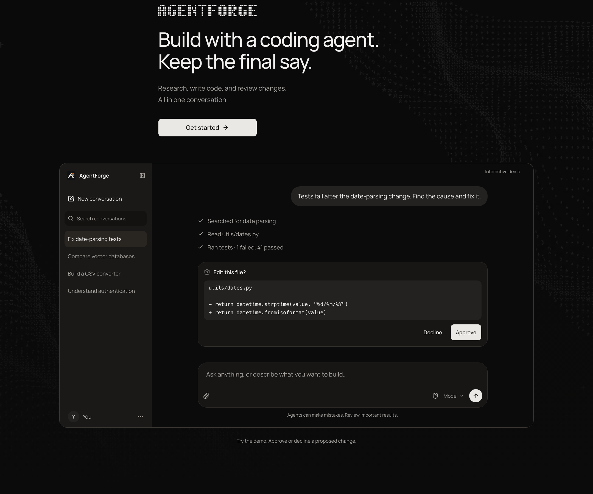
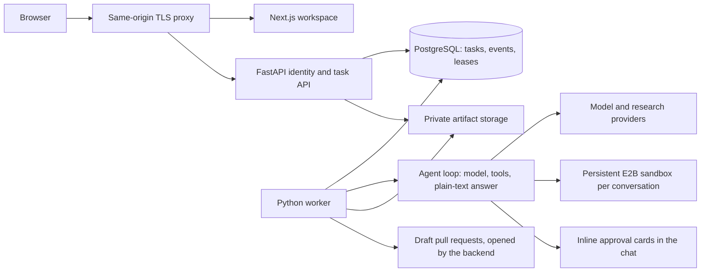

<div align="center">


# AgentForge

**Build with a coding agent. Keep the final say.**

A conversational workspace where one agent researches the web, writes and runs code in an isolated sandbox,
and prepares pull requests, while you approve every change before it happens.


[Quick start](#quick-start) ·
[Features](#features) ·
[Architecture](#architecture) ·
[Configuration](#configuration) ·
[Deployment](#deployment) ·
[Documentation](#documentation)

<br />



</div>

<br />

## Why AgentForge

Most coding agents either ask for permission constantly or none at all. AgentForge is built around a single honest
agent loop and a clear approval model:

- **One agent, no ceremony.** The model gets the conversation, a system prompt and its tools. It calls tools until it
  has what it needs, then answers in plain text, shown exactly as written. No router, planner or verifier rewrites it.
- **You decide what runs.** In **Ask me** mode the agent stops before anything that changes something (a command, a
  file write or edit, a pull request) and shows an Approve / Decline card with exactly what will happen. In
  **Approve for me** mode it never asks. Stop ends a run at any time.
- **Isolated by design.** Code runs in a persistent [E2B](https://e2b.dev) sandbox per conversation. The sandbox holds
  no secrets; GitHub writes are made by the backend with your own token, never from inside the sandbox.
- **Observable.** Every run keeps its event history and a usage ledger, and can be traced to
  [Neatlogs](https://neatlogs.com) (metadata only by default).

## Features

| | |
| --- | --- |
| **Research** | Web search (Exa, with Tavily as fallback) and page fetching with public-address and redirect checks. |
| **Code in a sandbox** | `bash`, `read`, `write`, `edit`, `grep`, `find` and `ls` in a per-conversation E2B sandbox; files and installed packages persist between messages. |
| **Repositories** | Select a GitHub repository per conversation. The agent reads a pinned commit, works on a copy and never sees your credentials. |
| **Delivery to GitHub** | Review the diff in the Changes panel, publish a branch, open a draft pull request and watch its checks. Merge and close are human-only. |
| **Live activity** | Notes, steps and the reply stream as the agent works, with a live context-size indicator and earlier steps folded away. |
| **Plugins** | Connect remote [MCP](https://modelcontextprotocol.io) servers (a reviewed catalog of services, or your own) and choose them per conversation. |
| **Skills** | Built-in and personal playbooks (code review, debugging, deep research, pull requests and more), loaded when a request fits or invoked with `/name`. |
| **Delegation** | The agent can hand independent assignments to child runs that work in parallel under the parent's limits and approvals. |
| **Custom agents** | Immutable, versioned agent definitions managed from Settings. |
| **Durable conversations** | Saved history, queued follow-ups, source-linked summaries and retrieval of original inputs. |
| **Sign-in** | GitHub App sign-in with revocable sessions, or a local bootstrap token for development. |

## Architecture



The API and the worker are separate processes that coordinate through PostgreSQL: the API accepts requests and serves
events, the worker leases tasks and runs the agent loop. Any OpenAI-compatible model endpoint can be used.

```text
apps/
  api/        FastAPI service, worker, agent runtime, migrations and tests (Python)
  web/        Next.js App Router workspace and landing pages (TypeScript, Tailwind CSS, shadcn/ui)
docs/         Reference documentation
infra/        Single-host deployment (Docker Compose, nginx) and the E2B sandbox template
scripts/      Local setup, dev runner and release checks
assets/       Brand master artwork
```

## Quick start

**Requirements:** Python 3.12 or 3.13, [uv](https://docs.astral.sh/uv/), Node.js 24, pnpm 10.34.6 (via corepack) and a
local PostgreSQL 16+ server. Dependencies are locked in `apps/api/uv.lock` and `apps/web/pnpm-lock.yaml`.

```sh
# 1. Check tools, create .env from the template if absent, install dependencies
scripts/dev-setup.sh

# 2. Edit .env: set DATABASE_URL and the LLM_* block (see Configuration below)

# 3. Create the schema, then a local sign-in identity
(cd apps/api && uv run alembic upgrade head)
(cd apps/api && uv run python -m agentforge.auth.bootstrap --write-env)

# 4. Verify the setup: one PASS/FAIL line per requirement
(cd apps/api && uv run python -m agentforge.doctor)

# 5. Start the API (:8000), the worker and the web app (:3000) together; Ctrl-C stops all
scripts/dev.sh
```

Open <http://localhost:3000>, choose **Get started** and enter the `LOCAL_BOOTSTRAP_TOKEN` from your `.env`.

> `scripts/dev-setup.sh --migrate` applies the migrations for you. It never overwrites an existing `.env`.

## Configuration

Settings live in an ignored root `.env`. [`.env.example`](.env.example) is the template and is kept to what you must or
may set; every other setting has a safe default. The API refuses to start on invalid settings and names the fields,
never their values.

| Setting | Purpose |
| --- | --- |
| `DATABASE_URL` | PostgreSQL connection (required). |
| `AUTH_MODE`, `LOCAL_USER_ID`, `LOCAL_BOOTSTRAP_TOKEN` | Local sign-in; filled in by the bootstrap command. |
| `LLM_MODEL`, `LLM_API_KEY`, `LLM_CONTEXT_WINDOW_TOKENS`, `LLM_*_USD_PER_MILLION` | Your OpenAI-compatible model (required to chat). |
| `E2B_API_KEY` | Enables the coding sandbox. |
| `EXA_API_KEY` / `TAVILY_API_KEY` | Enables web search; either works alone. |
| `NEATLOGS_API_KEY` | Enables tracing. |
| `PLUGIN_ENCRYPTION_KEY` | Lets people save plugin tokens and sign in to plugins (32+ random characters). |
| `ENABLE_GITHUB_WRITES` | Lets the agent open draft pull requests (needs a GitHub App). |
| `SITE_URL` | The public origin, set at web build time for the social card, sitemap and robots. |

For GitHub sign-in and private repositories, create a GitHub App as described in [docs/github-app.md](docs/github-app.md).
The complete list of settings with their defaults is in [docs/configuration.md](docs/configuration.md).

`API_ORIGIN` (in `apps/web/.env.local`, default `http://localhost:8000`) is the server-side origin that Next.js rewrites
`/api/` to; deployments route `/api/` straight to FastAPI on the same origin.

## Development

```sh
# API tests (unittest)
cd apps/api && uv run python -m unittest discover -s tests

# Web: tests, lint and types
cd apps/web
pnpm test:web
pnpm lint
pnpm exec next typegen && pnpm exec tsc --noEmit
```

Run the whole release gate from the repository root:

```sh
uv run --project apps/api python scripts/release_checks.py
```

It runs the unit checks, database fixtures on uniquely named disposable PostgreSQL databases and the frontend
lint, types and build, then writes private logs and a machine-readable receipt under the ignored `.local/releases/`.
The fixtures migrate and remove only the databases they create, and never call paid providers. The PostgreSQL user needs
`CREATE DATABASE`, or set `TEST_DATABASE_ADMIN_URL`. Use pnpm 10.34.6: a global pnpm 12 is incompatible with this lockfile.
The same checks run in [GitHub Actions](.github/workflows/ci.yml).

Adding a migration is covered in [apps/api/alembic/README.md](apps/api/alembic/README.md).

## Deployment

[`infra/deploy`](infra/deploy/README.md) contains a single-host configuration: nginx with TLS, the Next.js standalone
server, FastAPI, one worker and PostgreSQL on one Linux instance, with non-root services, least-privilege runtime
database access, encrypted persistent storage, backups and restore procedures. Production requires
`AUTH_MODE=github_app` and https origins.

This is a single-instance configuration: there is downtime during coordinated backups and no high-availability claim.
The container images and a hosted deployment have not been qualified on a real host yet, so treat the first deployment
as something to verify.

## Documentation

| Topic | Page |
| --- | --- |
| How the agent works: loop, tools, approvals, limits | [docs/agent.md](docs/agent.md) |
| Tool calling, validation and failure handling | [docs/agent-harness.md](docs/agent-harness.md) |
| System prompt and tool descriptions | [docs/agent-prompts.md](docs/agent-prompts.md) |
| Live notes, steps and streamed replies | [docs/live-activity.md](docs/live-activity.md) |
| Conversation context, history and compaction | [docs/context-management.md](docs/context-management.md) |
| Durable delivery, queued follow-ups and summaries | [docs/conversation-reliability.md](docs/conversation-reliability.md) |
| Workspace behavior and URLs | [docs/conversation-ux.md](docs/conversation-ux.md) |
| Branches, pull requests, checks and merging | [docs/delivery.md](docs/delivery.md) |
| Plugins (MCP servers) | [docs/plugins.md](docs/plugins.md) |
| Skills | [docs/skills.md](docs/skills.md) |
| Delegated assignments | [docs/subagents.md](docs/subagents.md) |
| GitHub App setup | [docs/github-app.md](docs/github-app.md) |
| Every setting and its default | [docs/configuration.md](docs/configuration.md) |
| Neatlogs tracing | [docs/neatlogs.md](docs/neatlogs.md) |
| Sandbox usage and cost reporting | [docs/sandbox-usage.md](docs/sandbox-usage.md) |
| E2B sandbox template | [infra/e2b/README.md](infra/e2b/README.md) |
| Single-host deployment | [infra/deploy/README.md](infra/deploy/README.md) |

## Security

- The sandbox has internet access and holds no secrets; credentials never enter it.
- GitHub writes use the signed-in person's own expiring token, are re-checked on every call, are fast-forward only and
  are never forced.
- Plugin servers are reached over https only, to public addresses only, without following redirects.
- Plugin credentials are stored encrypted, and provider errors shown in the chat have credentials removed.

Please report a suspected vulnerability privately to the maintainers rather than opening a public issue.
