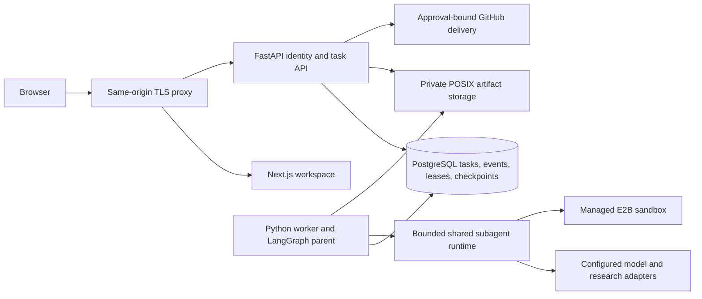

# AgentForge AI

AgentForge runs bounded research, general and repository coding tasks through a
shared subagent runtime. Each task keeps a durable plan, scoped grants, budget
ledger, event history and evidence-backed receipt. Coding commands run in managed
E2B sandboxes. Publishing a branch and draft pull request requires a separate,
single-use approval of the exact repository, commit, revision and diff.

The workspace supports persistent conversations and immutable custom-agent
versions. GitHub App sign-in uses durable, revocable sessions and retains the
user's own repository permissions. See [implementation status](phase-status.md)
and [qualification tracker](docs/remaining-phases.md) for tested boundaries.

Start a conversation and describe the work. AgentForge routes the request
automatically; the composer has an optional repository selection that defaults to
No repo. The sidebar focuses on conversations. Account, model/limits, GitHub
connections and custom-agent management live in Settings. See
[conversation behavior and migration](docs/conversation-ux.md) for the details.



## Development

Use Python 3.12–3.13, uv, Node 24 and pnpm **10.34.6**. Dependencies are locked in
`apps/api/uv.lock` and `apps/web/pnpm-lock.yaml`. Local development uses the existing
PostgreSQL service rather than deployment Compose. Keep credentials in an ignored
root `.env`; [Settings](apps/api/src/agentforge/settings.py) is the configuration
contract. Never overwrite an existing `.env` with a template.

```sh
cd apps/api
uv sync --locked
# Explicitly target a development database before either setup operation.
uv run alembic upgrade head
uv run python -m agentforge.workers.checkpoints setup
uv run uvicorn agentforge.main:app --host 127.0.0.1 --port 8000 --no-access-log
```

In separate terminals:

```sh
cd apps/api
uv run python -m agentforge.workers.runner
```

```sh
cd apps/web
corepack pnpm install --frozen-lockfile
corepack pnpm dev
```

Open `http://localhost:3000`. `API_ORIGIN` is a server-only HTTP(S) origin used by
Next.js's API rewrite; it defaults to `http://localhost:8000`. Deployments route
`/api/` directly to FastAPI and keep browser requests on the same origin. Configure
local single-user access or [GitHub identity](docs/phase-5.md) explicitly before
using protected routes. Provider names, tool/JSON support, context/output limits
and current per-token prices must be configured; missing keys fail closed.
Managed E2B setup is described in [infra/e2b](infra/e2b/README.md).

## Checks and release

From the repository root:

```sh
uv run --project apps/api python scripts/release_checks.py
```

This runs unit checks, uniquely named disposable PostgreSQL fixtures and frontend
lint/types/build. It writes private logs and a machine-readable receipt under
ignored `.local/releases/`. The local PostgreSQL OS-user administrator needs
CREATE DATABASE, or use `TEST_DATABASE_ADMIN_URL` naming the loopback administrative
`postgres` database. Fixtures migrate and remove only their newly created database;
they do not upgrade the configured application database or call paid providers.
Use pnpm 10.34.6; a global pnpm 12 installation is incompatible with this lockfile.

[Phase 7](docs/phase-7.md) maps golden fixtures to actual evidence and open gates.
[Single-EC2 deployment](infra/deploy/README.md) includes TLS, nonroot app services,
least-privilege runtime database access, persistent encrypted disk requirements,
backups, restore and restart procedures. Container execution and AWS deployment
remain unqualified until run on a deployment host. This is a single-instance
release configuration, with downtime during coordinated backups and no HA claim.

[Hackathon evidence](docs/hackathon.md) provides the partner-evidence checklist,
demo script and business-plan assumptions. A local fixture receipt is not live
provider evidence or a completed submission.
