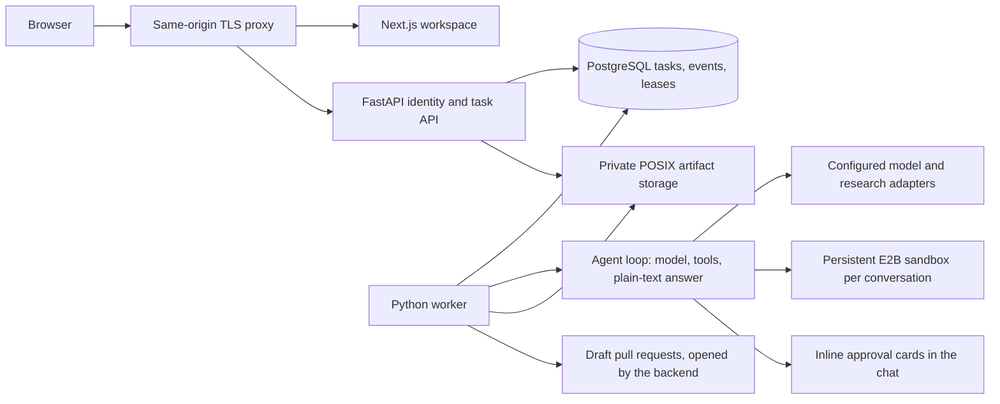

# AgentForge AI

AgentForge is a chat with one honest agent: a system prompt and a set of tools.
It answers directly, researches the web, reads and edits code in a sandbox, and
replies in plain text. The reply is shown exactly as the model wrote it. Nothing
grades it, wraps it in a status or limits how long it works; a provider's own
error is shown as it is, and Stop ends a run. See [the agent](docs/agent.md).

Coding runs in a persistent E2B sandbox per conversation (internet on, no
secrets inside). In **Ask me** mode the agent stops before anything that changes
something (a command, a file write or edit, a pull request) and the chat shows an
Approve / Decline card with exactly what will happen: the command, the file content
or edit, or the pull request's changed files. In **Approve for me** mode it never asks. Each task keeps
event history and a usage ledger.

The workspace supports persistent conversations and immutable custom-agent
versions. GitHub App sign-in uses durable, revocable sessions and retains the
user's own repository permissions. See [implementation status](phase-status.md)
and [qualification tracker](docs/remaining-phases.md) for tested boundaries.

Start a conversation and describe the work. The composer has an optional
repository selection that defaults to No repo, and the Ask me / Approve for me
switch. The sidebar focuses on conversations. Account, model/limits, GitHub
connections and custom-agent management live in Settings. See
[conversation behavior and migration](docs/conversation-ux.md) for the details.
Durable queued follow-ups, source-linked conversation summaries, original-input
retrieval and deployment requirements are documented in
[conversation reliability](docs/conversation-reliability.md).



## Development

Use Python 3.12–3.13, uv, Node 24 and pnpm **10.34.6** (via corepack), with a local
PostgreSQL server. Dependencies are locked in `apps/api/uv.lock` and
`apps/web/pnpm-lock.yaml`.

```sh
scripts/dev-setup.sh          # checks tools, creates .env from .env.example if absent, installs dependencies
# edit .env: DATABASE_URL and the LLM_* block
(cd apps/api && uv run alembic upgrade head)                                  # or: scripts/dev-setup.sh --migrate
(cd apps/api && uv run python -m agentforge.auth.bootstrap --write-env)       # local sign-in
(cd apps/api && uv run python -m agentforge.doctor)                           # PASS/FAIL per requirement
scripts/dev.sh                # API :8000, worker and web :3000 together; Ctrl-C stops all
```

Open `http://localhost:3000` and enter the `LOCAL_BOOTSTRAP_TOKEN` from `.env`.
Configuration lives in an ignored root `.env`; [.env.example](.env.example) lists
every setting and [Settings](apps/api/src/agentforge/settings.py) is the contract.
The API refuses to start on invalid settings and names the fields, never their
values. Never overwrite an existing `.env` with the template. For GitHub sign-in
and private repositories, create a GitHub App as in [docs/github-app.md](docs/github-app.md).
Set `E2B_API_KEY` for the coding sandbox and `TAVILY_API_KEY` for web search.
`API_ORIGIN` (in `apps/web/.env.local`, default `http://localhost:8000`) is the
server-only origin of Next.js's API rewrite; deployments route `/api/` directly
to FastAPI on the same origin.

## Checks and release

From the repository root:

```sh
uv run --project apps/api python scripts/release_checks.py
```

This runs unit checks, uniquely named disposable PostgreSQL fixtures and frontend
lint/types/build. It writes private logs and a machine-readable receipt under
ignored `.local/releases/`. The local PostgreSQL OS-user administrator needs
CREATE DATABASE, or use `TEST_DATABASE_ADMIN_URL` naming the loopback administrative
`postgres` database. Fixtures migrate and remove only their newly created database;
they do not upgrade the configured application database or call paid providers.
Use pnpm 10.34.6; a global pnpm 12 installation is incompatible with this lockfile.

[Phase 7](docs/phase-7.md) maps golden fixtures to actual evidence and open gates.
[Single-EC2 deployment](infra/deploy/README.md) includes TLS, nonroot app services,
least-privilege runtime database access, persistent encrypted disk requirements,
backups, restore and restart procedures. Container execution and AWS deployment
remain unqualified until run on a deployment host. This is a single-instance
release configuration, with downtime during coordinated backups and no HA claim.

[Hackathon evidence](docs/hackathon.md) provides the partner-evidence checklist,
demo script and business-plan assumptions. A local fixture receipt is not live
provider evidence or a completed submission.
